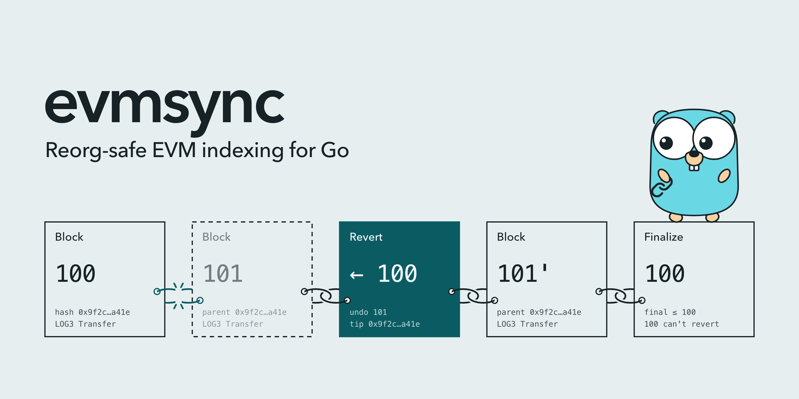

<p align="center">
  <picture>
    <source media="(prefers-color-scheme: dark)" srcset=".github/assets/readme-dark.png">
    
  </picture>
</p>

<p align="center">
  <b>Reorg-safe EVM indexing for Go: a canonical log of the chain that your state can roll back with.</b>
</p>

<p align="center">
  <a href="https://github.com/hmdsefi/evmsync/actions/workflows/build.yml"></a>
  <a href="https://github.com/hmdsefi/evmsync/actions/workflows/build.yml?query=branch%3Amain"></a>
  <a href="https://pkg.go.dev/github.com/hmdsefi/evmsync"></a>
  <a href="https://github.com/hmdsefi/evmsync/releases"></a>
  <a href="go.mod"></a>
  <a href="LICENSE"></a>
  <a href="https://github.com/sponsors/hmdsefi"></a>
</p>

<p align="center">
  <a href="https://pkg.go.dev/github.com/hmdsefi/evmsync"><b>Documentation</b></a> ·
  <a href="https://github.com/hmdsefi/evmsync/issues/84"><b>Roadmap</b></a> ·
  <a href="CHANGELOG.md"><b>Changelog</b></a>
</p>

evmsync is a framework for indexing Ethereum and other EVM chains in Go. It turns a chain into
an append-only *canonical log* of three kinds of entry: `Block`, `Revert` and `Finalize`. A chain
reorg becomes a new `Revert` entry, never an edit, so anything that applies the log in order rolls
its state back to the common ancestor and applies the new blocks with no reorg code of its own.

## Status

v0.1.0 contains the core: the canonical log in memory and as a file write-ahead log (WAL), the chain
tracker that detects reorgs and finality, and the consumer runtime. Ingest from a JSON-RPC
provider, typed event handlers and the Postgres store arrive in later versions; the
[roadmap issue](https://github.com/hmdsefi/evmsync/issues/84) lists each version and its progress.
The API changes between minor versions until v1.0.0.

## Install

evmsync needs Go 1.26 or later.

```sh
go get github.com/hmdsefi/evmsync@v0.1.0
```

## Example

This program writes the log from the banner, where block 101 is replaced by block 101', and runs a
consumer over it. The consumer's state is the list of blocks it applied.

```go
ctx := context.Background()
log := chainlog.NewMemory(chainlog.Meta{ChainID: 1, Start: 100}, chainlog.DefaultWindowCap)

b100 := chain.BlockRef{Number: 100, Hash: common.HexToHash("0xa0")}
b101 := chain.BlockRef{Number: 101, Hash: common.HexToHash("0xa1"), Parent: b100.Hash}
b101x := chain.BlockRef{Number: 101, Hash: common.HexToHash("0xb1"), Parent: b100.Hash}
log.Append(ctx,
	chainlog.Entry{Kind: chainlog.KindBlock, Block: chain.Block{Ref: b100}},
	chainlog.Entry{Kind: chainlog.KindBlock, Block: chain.Block{Ref: b101}},
	chainlog.Entry{Kind: chainlog.KindRevert, To: b100},
	chainlog.Entry{Kind: chainlog.KindBlock, Block: chain.Block{Ref: b101x}},
	chainlog.Entry{Kind: chainlog.KindFinalize, To: b100},
)

c := consumer.NewMemory([]uint64(nil),
	func(s []uint64, b chain.Block) []uint64 { return append(s, b.Ref.Hash.Big().Uint64()) },
	func(s []uint64) []uint64 { return append([]uint64(nil), s...) },
)
runCtx, cancel := context.WithTimeout(ctx, 100*time.Millisecond)
defer cancel()
consumer.Run(runCtx, log, c) // follows the log until runCtx ends
fmt.Printf("%x\n", c.State()) // [a0 b1]
```

Block `a1` was applied and then rolled back by the `Revert` entry, so the state holds only the
canonical chain. That is the *reorg invariant* evmsync tests on every change: the state after
applying the log equals the state computed from the final canonical chain alone.

## Packages

Each package has its own documentation on [pkg.go.dev](https://pkg.go.dev/github.com/hmdsefi/evmsync).

- [`chain`](https://pkg.go.dev/github.com/hmdsefi/evmsync/chain): blocks, logs, the ingest filter
  with its bloom check, and the `Source` interface a chain is read through.
- [`chainlog`](https://pkg.go.dev/github.com/hmdsefi/evmsync/chainlog): the log entries, their
  binary record format, the validator every append goes through, and the in-memory log.
- [`chainlog/wal`](https://pkg.go.dev/github.com/hmdsefi/evmsync/chainlog/wal): the durable log, in
  checksummed segment files, with torn-tail recovery on open and compaction below the finalized
  block.
- [`tracker`](https://pkg.go.dev/github.com/hmdsefi/evmsync/tracker): turns new heads and finalized
  blocks into log entries, finds the common ancestor of a reorg by following parent hashes, and
  stops with a typed error on a reorg below the finalized block or a full window.
- [`consumer`](https://pkg.go.dev/github.com/hmdsefi/evmsync/consumer): `Run`, which feeds a
  consumer the log from its committed offset, and `Memory`, a consumer for in-memory state.

## What "evmsync" means here

The name is literal on purpose: it's two words, and each one says something.

**1. EVM.** The *Ethereum Virtual Machine* is the execution environment shared by
Ethereum and a large family of chains: Base, Arbitrum, Optimism, Polygon, BNB
Chain, Avalanche C-Chain, and more. They all expose the same JSON-RPC API, the
same log format, and the same ABI encoding. That's why one framework and one set
of typed handlers can index any of them, often several at once.

**2. sync.** evmsync isn't a one-time import. It keeps your database continuously
in sync with the chain, which is the source of truth, the way a database replica
follows its primary:

| Database replica | evmsync |
|---|---|
| Initial snapshot copy | **Backfill**: replay historical blocks |
| Follows the primary's log | **Realtime**: follow the chain head, block by block |
| Applies changes in order | Runs your handlers in block and log order |
| Handles the primary rewriting history | **Reorgs**: rolls your state back to the common ancestor and reapplies the new canonical blocks |
| Resumes after a crash without gaps or duplicates | Checkpoints and resumes exactly where it stopped |

The important part is that sync goes **both ways in time**: forward when new
blocks arrive, and backward when the chain reorganizes. Most hand-rolled indexers
only handle forward.

**What it doesn't mean:**

- **It isn't node sync.** In go-ethereum, "sync" (snap sync, full sync) means
  downloading the entire blockchain into a node. evmsync doesn't run a node or store
  the chain. It reads from RPC providers and keeps only the events you subscribe
  to, transformed by your handlers.
- **It isn't cross-chain sync.** It doesn't bridge assets or relay state between
  chains. Indexing several chains means several independent sources feeding
  your database.
- **It's read-only.** It never sends transactions.

## Related projects

Several good indexers solve parts of the same problem, in other languages or with other models:

- [Ponder](https://ponder.sh) (TypeScript) is the closest in spirit: typed handlers that write to
  your own Postgres tables, rolled back on reorgs.
- [Envio HyperIndex](https://envio.dev) and [SQD](https://sqd.dev) are multichain indexing
  frameworks, each backed by its own data network for fast historical reads.
- [The Graph](https://thegraph.com) runs subgraphs on graph-node and serves them over GraphQL.
- [rindexer](https://rindexer.xyz) (Rust) builds an indexer from a YAML file or as a framework.
- [Shovel](https://indexsupply.com/shovel) (Go) copies Ethereum data into Postgres from a
  configuration file.

evmsync is a Go library: the log, your consumers and your store run in your own process.

## License

evmsync is licensed under the [Apache License 2.0](LICENSE).

## Credits

The gopher in the banner is drawn after the Go gopher, designed by
[Renee French](https://reneefrench.blogspot.com/) and licensed under
[CC BY 4.0](https://creativecommons.org/licenses/by/4.0/).
